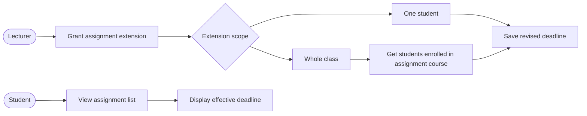
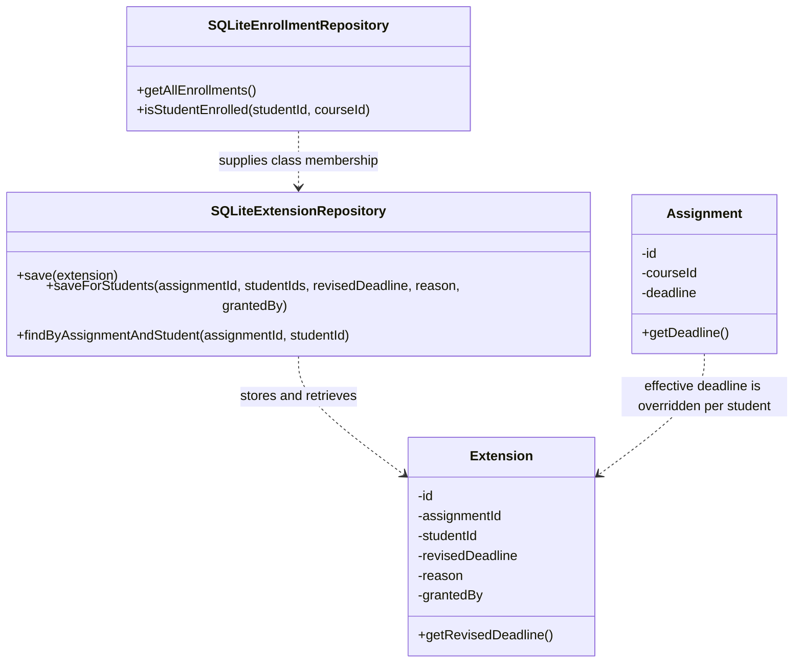
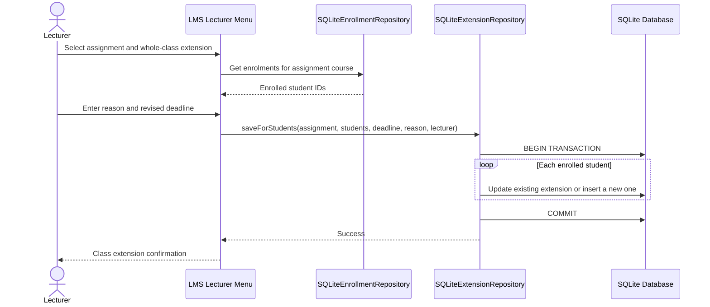

# Phase 8 – Updated Design Documents for CR1

## Updated use-case view



## Updated class view



## Class-wide extension sequence



## Student assignment-list sequence

```mermaid
sequenceDiagram
    actor Student
    participant UI as Student Menu
    participant Assign as SQLiteAssignmentRepository
    participant Ext as SQLiteExtensionRepository

    Student->>UI: View assignments
    UI->>Assign: Get assignments for enrolled course
    Assign-->>UI: Assignment list and original deadlines
    loop Each assignment
      UI->>Ext: findByAssignmentAndStudent(assignmentId, studentId)
      Ext-->>UI: Extension record or no record
    end
    UI-->>Student: Display revised deadline when present; otherwise original deadline
```

## Database impact

No schema migration is required. The existing `extensions` table continues to store an extension for an assignment/student pair. A class-wide extension applies the same revised deadline, reason and granting lecturer to each student in the selected course. Existing records are updated and missing records are inserted within one transaction.

## Deployment impact

No change to the deployment topology. The LMS executable and SQLite database remain deployed on the single Windows school computer.
